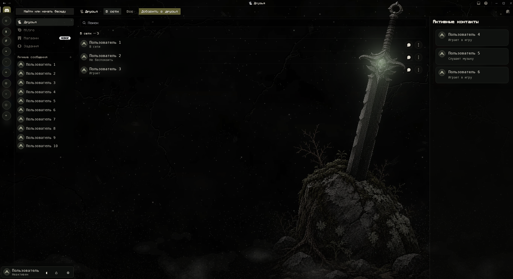
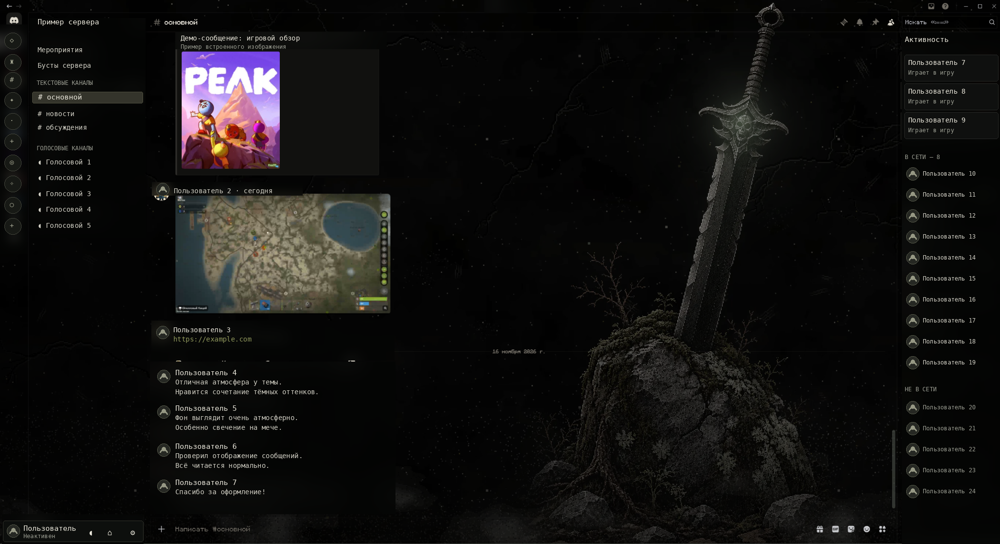

# Fantasy sword

**A forgotten blade, a world swallowed by darkness.**  
**Забытый клинок в мире, поглощённом тьмой.**

[English](#english) · [Русский](#русский)

## Preview / Предпросмотр

### Friends view / Экран друзей



### Server view / Экран сервера



*The previews are based on the actual theme screenshots, with user, server, and contact details replaced by placeholders.*  
*Превью основаны на настоящих скриншотах темы; имена пользователей, серверы и личная информация заменены заглушками.*

---

## English

### About

**Fantasy sword** is a dark-fantasy theme for [BetterDiscord](https://betterdiscord.app/), centered around a massive sword embedded in an ancient, moss-covered rock. A nearly black, dithered landscape, muted stone-and-olive palette, subtle particles, ground fog, and a softly glowing sword guard set the mood.

The Discord interface is kept minimal and translucent so the artwork remains visible across the friends list, servers, and chat.

### Features

- **Dark fantasy artwork:** A monumental sword, weathered stone, sparse vegetation, and a nearly black background.
- **Atmospheric effects:** Animated floating dust, bottom fog, and a subtle glow around the sword's guard.
- **Pixel-inspired typography:** An embedded [Monocraft](https://github.com/IdreesInc/Monocraft) font and optional pixel-style text shadows.
- **Muted palette:** Bone-white text, desaturated olive accents, and dark translucent panels.
- **Customizable appearance:** Adjust dimming, panel opacity, vignette, corners, and visual effects in the theme's `:root` section.
- **Self-contained theme:** The main artwork and effect textures are embedded directly in the CSS file.

### Installation

1. Install [BetterDiscord](https://betterdiscord.app/).
2. Download **`Fantasy sword.theme.css`** from this repository.
3. Open **Discord → User Settings → BetterDiscord → Themes**.
4. Click **Open Themes Folder** and copy the `.theme.css` file into that folder.
5. Return to Discord and enable **Fantasy sword**.

### Customization

Open `Fantasy sword.theme.css` in any text editor. The options are near the beginning of the file under `:root`.

| Variable | Purpose | Default |
| --- | --- | --- |
| `--sis-dim` | Overall background dimming (`0`–`1`) | `0.2` |
| `--sis-chat-dim` | Additional dimming behind the chat | `0.3` |
| `--sis-panel-dim` | Sidebar and panel dimming | `0.45` |
| `--sis-radius` | Interface corner radius | `2px` |
| `--sis-vignette` | Edge darkening strength | `0.55` |
| `--sis-particles` | Floating dust (`block` / `none`) | `block` |
| `--sis-fog` | Bottom fog (`block` / `none`) | `block` |
| `--sis-glow` | Sword-guard glow (`block` / `none`) | `block` |

For example, to disable the ambient effects:

```css
:root {
  --sis-particles: none;
  --sis-fog: none;
  --sis-glow: none;
}
```

These values can be changed directly in the theme file. The snippets above illustrate the settings; they do not require an additional plugin.

### Notes

- Changes to Discord may affect the appearance of some interface elements.
- The artwork and font are embedded in the CSS; a separate background download is not needed.
- Animated effects may affect performance on some systems. Disable individual effects in `:root` if necessary.

### Credits

- **Theme / CSS:** Washed
- **Font:** [Monocraft](https://github.com/IdreesInc/Monocraft) by Idrees Hassan and contributors, licensed under the [SIL Open Font License 1.1](https://openfontlicense.org/).

---

## Русский

### О теме

**Fantasy sword** — тема для [BetterDiscord](https://betterdiscord.app/) в эстетике тёмного фэнтези. В центре композиции находится огромный меч, вонзённый в древний камень, покрытый мхом. Почти чёрный фон с дизерингом, приглушённая каменно-оливковая палитра, летающие частицы, туман у земли и мягкое свечение гарды создают атмосферу заброшенного фантастического мира.

Интерфейс Discord остаётся минималистичным и полупрозрачным, поэтому иллюстрация видна как на экране друзей, так и внутри серверов и чатов.

### Особенности

- **Атмосфера тёмного фэнтези:** Огромный меч, состаренный камень, редкая растительность и почти чёрное окружение.
- **Атмосферные эффекты:** Анимированная пыль, туман в нижней части экрана и слабое свечение гарды меча.
- **Пиксельная типографика:** Встроенный шрифт [Monocraft](https://github.com/IdreesInc/Monocraft) и настраиваемая тень текста.
- **Приглушённая палитра:** Светлые костяные оттенки текста, оливковые акценты и затемнённые полупрозрачные панели.
- **Настройка интерфейса:** Можно изменять затемнение, прозрачность панелей, виньетку, скругления и визуальные эффекты через `:root`.
- **Один файл:** Основная иллюстрация и текстуры эффектов встроены непосредственно в CSS.

### Установка

1. Установите [BetterDiscord](https://betterdiscord.app/).
2. Скачайте из репозитория файл **`Fantasy sword.theme.css`**.
3. Откройте **Discord → Настройки пользователя → BetterDiscord → Темы**.
4. Нажмите **Открыть папку тем** (*Open Themes Folder*) и поместите туда файл `.theme.css`.
5. Вернитесь в Discord и включите **Fantasy sword**.

### Настройка

Откройте файл `Fantasy sword.theme.css` в любом текстовом редакторе. Основные параметры находятся в самом начале файла, в блоке `:root`.

| Переменная | Назначение | По умолчанию |
| --- | --- | --- |
| `--sis-dim` | Общее затемнение фона (`0`–`1`) | `0.2` |
| `--sis-chat-dim` | Дополнительное затемнение области чата | `0.3` |
| `--sis-panel-dim` | Затемнение боковых панелей | `0.45` |
| `--sis-radius` | Скругление элементов интерфейса | `2px` |
| `--sis-vignette` | Сила затемнения краёв экрана | `0.55` |
| `--sis-particles` | Летающая пыль (`block` / `none`) | `block` |
| `--sis-fog` | Туман внизу экрана (`block` / `none`) | `block` |
| `--sis-glow` | Свечение гарды меча (`block` / `none`) | `block` |

Например, чтобы отключить атмосферные эффекты:

```css
:root {
  --sis-particles: none;
  --sis-fog: none;
  --sis-glow: none;
}
```

Значения можно изменить прямо в CSS-файле. Дополнительные плагины для настройки не нужны.

### Примечания

- После обновлений Discord отдельные элементы интерфейса могут выглядеть иначе.
- Иллюстрация и шрифт уже встроены в CSS, поэтому отдельно скачивать фон не нужно.
- Анимированные эффекты могут влиять на производительность. При необходимости их можно отключить в `:root`.

### Авторы

- **Тема / CSS:** Washed
- **Шрифт:** [Monocraft](https://github.com/IdreesInc/Monocraft), автор Idrees Hassan и участники проекта, лицензия [SIL Open Font License 1.1](https://openfontlicense.org/).

---

*Independent BetterDiscord theme. Not affiliated with Discord or BetterDiscord.*  
*Независимая тема для BetterDiscord. Не связана с Discord или BetterDiscord.*
